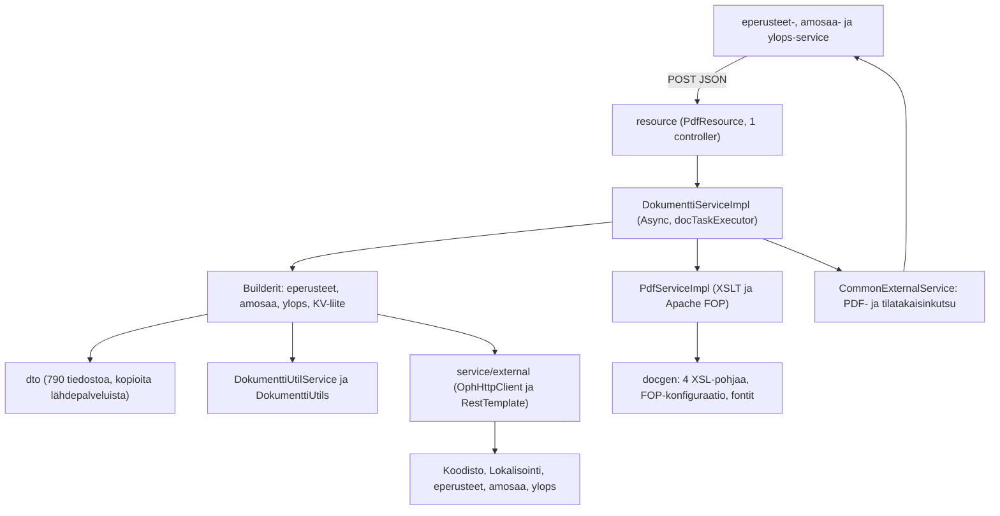
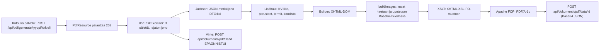
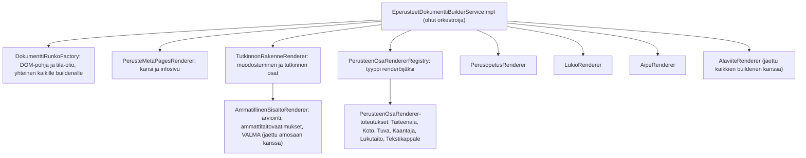
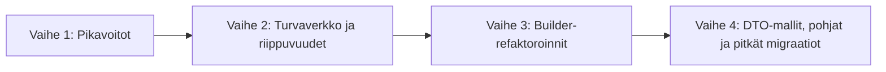

# eperusteet-pdf - parannussuunnitelma

| Tieto | Arvo |
|---|---|
| Dokumentin luontipäivä | 22.10.2026 |
| Laatija | Cursor-agentti |
| Käytetty malli | Claude Opus 5.5 |
| Laajuus | `eperusteet-pdf-service` (Spring Boot 4.1.1, Java 21, Apache FOP 2.11) |
| Koko | 865 Java-tiedostoa / noin 31 800 riviä (main), 8 tiedostoa / 355 riviä (test). Pohjat: 4 XSL-tiedostoa / 4 791 riviä, 3 FOP-konfiguraatiota (3 x 512 riviä), 3 käännöstiedostoa ja 12 fonttia. |

Luvut perustuvat staattiseen koodianalyysiin (`wc -l`, hakulausekkeet, käsin luetut luokat, `mvn -o dependency:list`). Ne ovat suuntaa-antavia ja kannattaa tarkistaa ennen kunkin työn aloittamista.

---

## 1. Yhteenveto

Palvelu on tilaton PDF-generaattori. Se vastaanottaa eperusteet-, amosaa- ja ylops-palveluilta dokumentin sisällön JSON-muodossa, rakentaa siitä XHTML-DOMin Javalla, muuntaa sen XSLT:llä XSL-FO-muotoon ja tuottaa PDF/A-1b-tiedoston Apache FOPilla. Valmis PDF lähetetään takaisin kutsuvalle palvelulle HTTP-takaisinkutsulla. Alusta on ajantasainen (Spring Boot 4.1.1, Spring Framework 7, FOP 2.11), joten tekninen velka johtuu seuraavista asioista:

1. **Suuret builder-luokat (god class).** `EperusteetDokumenttiBuilderServiceImpl` on 2911 riviä, ja siinä on 63 yksityistä metodia, joista kuusi on yli 100 riviä pitkiä. `AmosaaDokumenttiBuilderServiceImpl` (1784 riviä) ja `Lops2019DokumenttiServiceImpl` (1351 riviä) noudattavat samaa mallia. Builder-luokat muodostavat noin 70 % kaikesta muusta kuin DTO-koodista.
2. **Kopioidut DTO-mallit.** 790 DTO-tiedostoa (63 % main-koodin riveistä) on käsin kopioitu kolmesta lähdepalvelusta. 123 luokkanimeä esiintyy useammassa kuin yhdessä paketissa, ja noin 168 DTO-luokkaan ei viitata mistään. Kopiot ovat jo erkaantuneet lähteistään.
3. **Testit.** Testejä on 8 kappaletta kahdessa luokassa. Integraatiotesti tarkistaa vain, ettei generointi heitä poikkeusta. PDF:n tai välivaiheen XHTML:n sisältöä ei tarkisteta lainkaan.
4. **Riippuvuudet.** Parent-pom tuo tilattomaan palveluun koko tietokantapinon (32 artefaktia: JPA, Hibernate, Envers, Flyway, Spring Session JDBC, HikariCP, PostgreSQL-ajuri). Lisäksi mukana on kuusi OPH:n SNAPSHOT-kirjastoa, testikirjastoja compile-scopessa, sekaisin Batik-versioita 1.13 ja 1.19 sekä kirjastoja, joita koodi ei käytä lainkaan (PDFBox, Gson, StreamEx, Tika).

Suurin hyöty saadaan pilkkomalla builder-luokat sisältötyyppikohtaisiin renderöijiin ja yhdistämällä eperusteet- ja amosaa-puolen lähes identtinen ammatillisen sisällön renderöinti. Ennen sitä tarvitaan turvaverkoksi XHTML-tulosteeseen perustuvat vertailutestit. Pienimmällä työllä saadaan pikavoittoja: siivotaan riippuvuuksien scopet ja käyttämättömät kirjastot, korjataan hiljaiset `catch`-lohkot ja konfiguraatiovirheet.

---

## 2. Arkkitehtuuri

### 2.1 Kerrokset

| Paketti | Tiedostoja | Rivejä (noin) | Rooli |
|---|---:|---:|---|
| `dto` | 790 | 20 100 | Lähdepalveluista kopioidut siirto-oliot ja dokumentin apuoliot |
| `dto/eperusteet` | 274 | 7 100 | eperusteet-servicen DTO:t |
| `dto/ylops` | 236 | 5 300 | ylops-servicen DTO:t |
| `dto/amosaa` | 193 | 4 800 | amosaa-servicen DTO:t |
| `dto/enums` | 59 | 1 800 | Enumit (osin päällekkäisiä backend-utilsin kanssa) |
| `dto/common`, `dto/dokumentti` | 27 | 1 100 | Yhteiset DTO:t ja generoinnin tila-oliot (`DokumenttiBase` ja aliluokat) |
| `service` | 36 | 9 600 | Builderit, PDF-muunnos ja ulkoiset clientit |
| `service/eperusteet` | 4 | 3 500 | Perusteen ja KV-liitteen builderit |
| `service/ylops` | 10 | 2 900 | Ylops-builder ja koulutustyyppikohtaiset osat |
| `service/amosaa` | 2 | 1 800 | Amosaa-builder |
| `service/external` | 12 | 700 | HTTP-clientit lähdepalveluille, koodistolle ja lokalisoinnille |
| `service` (juuri) | 8 | 600 | `DokumenttiServiceImpl`, `PdfServiceImpl`, `DokumenttiUtilServiceImpl`, käännökset |
| `utils` | 17 | 1 300 | Staattiset DOM-apufunktiot (`DokumenttiUtils`), HTML-sanitointi |
| `configuration` | 14 | 600 | Tietoturva, async, Jackson, Orika, HTTP-clientit |
| `exception` | 6 | 130 | Poikkeukset ja async-virhekäsittelijä |
| `resource` | 1 | 70 | REST-rajapinta (`PdfResource`) |

### 2.2 Poikkileikkaavat ratkaisut

- **Tietoturva:** CAS (`spring-security-cas`, `OpintopolkuCasAuthenticationFilter`) profiileissa `default` ja `hahtuva`. `POST /api/pdf/**` vaatii tunnistautumisen, mutta `GET /api/**` on avoin, joten myös jonon tilan näyttävä `/api/pdf/info` on julkinen. `@EnableMethodSecurity` on päällä, mutta yhtään metoditason annotaatiota ei ole. Profiileissa `local` ja `jar` kaikki POST-kutsut sallitaan ilman tunnistautumista.
- **Välimuisti:** Spring Cache ja Ehcache 3 (`ehcache.xml`): `koodistot` ja `lokalisoinnit`, TTL 1 tunti, 2000 alkiota. `KoodistoClientImpl` injektoi itsensä `@Lazy`-annotaatiolla välimuistiproxyn takia. Lokalisoinnin välimuisti ei tallenna tyhjiä tuloksia (`unless="#result == null"`).
- **Async:** `DokumenttiAsyncConfig` määrittää `docTaskExecutor`in (`corePoolSize` 3, jonon kokoa ei ole rajattu). Kaikki neljä generointimetodia ovat `@Async`. Työt ovat vain muistissa, joten uudelleenkäynnistys tai deploy hävittää jonossa olevat työt. Käyttämätön `schedulingExecutor`-bean on määritelty samassa luokassa.
- **Ulkoiset integraatiot:** Lähdepalveluihin on kaksi HTTP-pinoa rinnakkain: `OphHttpClient` (CAS, `RestClientFactory`) ja `RestTemplate` (HttpClient 5 -pooli). `RestClientFactory.get` luo jokaisella kutsulla uuden `OphHttpClient`- ja `CasAuthenticator`-instanssin (6 kutsupaikkaa). `LokalisointiServiceImpl` luo uuden `RestTemplate`n jokaisella kutsulla.
- **Takaisinkutsut:** `CommonExternalServiceImpl.postPdfData` lähettää PDF:n Base64-koodattuna JSONina osoitteeseen `/api/dokumentit/pdf/data/{id}`, ja virhetilanteessa `updateDokumenttiTila` lähettää tilan `EPAONNISTUI` osoitteeseen `/api/dokumentit/pdf/tila/{id}`. URL valitaan `DokumenttiTyyppi`n mukaan.
- **Tietokanta:** Ei ole. `DataSourceAutoConfiguration` on suljettu pois, mutta parent-pomin tietokantariippuvuudet ovat silti classpathissa.
- **CI:** `.github/workflows/build.yml` ajaa `mvn clean verify -B` (sisältää failsafe-integraatiotestit) ja rakentaa kontin `ci-tools`-työkaluilla. Docgen-hakemisto (fontit ja XSL) kopioidaan konttiin erikseen. `setup-java` käyttää vanhentunutta jakelua `adopt`. Repositoriossa ei ole Dependabot- tai Renovate-konfiguraatiota.

### 2.3 Havainnot

- Kerrosjako on yksinkertainen, mutta logiikka on keskittynyt builder-luokkiin: neljä suurinta builderia kattaa 6 795 riviä eli 58 % muusta kuin DTO-koodista.
- Jokainen dokumenttityyppi on toteutettu omana kokonaisuutenaan (oma builder, oma XSL-pohja, omat DTO-kopiot), vaikka sisältö on pitkälti samaa. Ammatillista sisältöä renderöidään sekä eperusteet- että amosaa-builderissa lähes identtisellä koodilla.
- `spring.main.allow-circular-references=true` toistuu kuudessa properties-tiedostossa, vaikka ainoa sykli (`KoodistoClientImpl.self`) on jo ratkaistu `@Lazy`-injektiolla.
- `@Value`-oletusarvo `''` tuottaa kirjaimellisen merkkijonon `''` eikä tyhjää arvoa (16 kohtaa 7 tiedostossa). `CommonExternalServiceImpl`in rivillä 56 on lisäksi ylimääräinen heittomerkki, joten amosaan sisäinen URL alkaa heittomerkillä profiileissa, joissa `amosaa-service.internal` puuttuu (`hahtuva`, `qa`, `jar`).
- Projekti käyttää parent-pomia `eperusteet-parent-pom:4.1.1-10`, kun eperusteet-service on jo versiossa `4.1.1-11`.

---

## 3. Sovelluslogiikka

### 3.1 PDF-generoinnin putki

- `PdfResource` ottaa rungon vastaan `String`inä ja palauttaa aina `202 Accepted`. Varsinainen työ tehdään `DokumenttiServiceImpl`in `@Async`-metodeissa (`generateForEperusteet`, `generateForEperusteetKvLiite`, `generateForAmosaa` ja `generateForYlops`), jotka ovat rakenteeltaan lähes identtisiä.
- Ylops-dokumentille haetaan lisäksi perusteen koko sisältö ylops-palvelusta. Amosaa-dokumentille haetaan `PerusteKaikkiDto` jokaiselle sisältöviitteelle, jolla on peruste, ilman deduplikointia tai välimuistia. Yksittäinen `PerusteKaikkiDto` voi olla megatavujen kokoinen (testiaineiston `ylops-peruste.json` on noin 8 Mt).
- `PdfServiceImpl.xhtml2pdf` tekee kolme muistissa olevaa muunnosta (DOM tavuiksi, XSL-FO tavuiksi, PDF tavuiksi). Se luo jokaiselle dokumentille uuden `FopFactory`n (fonttien lataus) ja kääntää XSLT-pohjan joka kerta uudelleen.

### 3.2 Templating

- XHTML rakennetaan imperatiivisesti `org.w3c.dom`-rajapinnalla (`createElement`, `setAttribute`) suoraan builder-luokissa. Erillistä template-moottoria ei ole.
- Ulkoasu määritellään neljässä XSL-tiedostossa: `xhtml-to-xslfo-eperusteet.xsl` (1541 riviä), `xhtml-to-xslfo-ylops.xsl` (1364), `xhtml-to-xslfo-amosaa.xsl` (1287) ja `kvliite.xsl` (599). Kolme ensimmäistä ovat rivitasolla 80-84 % samankaltaisia, joten ulkoasumuutos on tehtävä kolmeen paikkaan.
- `fop.xconf`, `fop-dev.xconf` ja `fop-local.xconf` ovat kukin 512 riviä ja eroavat vain fonttien poluista. `fop-local.xconf` sisältää kovakoodatun Windows-polun `c:/workspace/eperusteet-pdf-service/...`.
- Käännökset haetaan ensin lokalisointipalvelusta ja sitten paikallisista tiedostoista. Paikallisissa tiedostoissa on suomeksi 265, ruotsiksi 136 ja englanniksi 78 avainta. Koska lokalisoinnin välimuisti ei tallenna tyhjiä tuloksia, jokainen lokalisointipalvelusta puuttuva avain aiheuttaa HTTP-kutsun jokaisella käännöksellä.

### 3.3 Datan vastaanotto ja haku

- Data vastaanotetaan kutsun rungossa JSON-merkkijonona ja deserialisoidaan palvelun omiin DTO-kopioihin. Jackson on asetettu sietämään tuntemattomat kentät (`FAIL_ON_UNKNOWN_PROPERTIES=false`), joten lähdepalvelun mallin muutokset eivät näy virheinä vaan puuttuvana sisältönä PDF:ssä.
- Esimerkki erkaantumisesta: eperusteet-servicen `PerusteKaikkiDto` sisältää kentät `kvLiite` ja `muutosmaarayksenVoimassaoloAlkaa`, mutta PDF-palvelun kopiossa niitä ei ole. PDF-palvelu hakee KV-liitteen erillisellä CAS-kutsulla (`EperusteetServiceImpl.getKvLiite`).
- Generoituja clienteja tai jaettua DTO-artefaktia ei käytetä. Backend-utilsista käytetään vain muutamaa luokkaa (`RestClientFactory`, `Kieli`, `Tila`, `DokumenttiMetaDto`, `LokalisoituTekstiDto`). Osa niistä on päällekkäisiä palvelun omien luokkien kanssa: `Kieli` on sekä `pdf.dto.enums`issa (37 tiedostoa käyttää) että backend-utilsissa (9 tiedostoa).
- Orikaa käytetään vain seitsemässä `mapper.map`-kutsussa ja kahdeksassa `classMap`-määrityksessä. `EperusteetDokumenttiBuilderServiceImpl` injektoi `MapperFacade`n, mutta ei käytä sitä.

### 3.4 Virheenkäsittely

- `DokumenttiServiceImpl` sieppaa kaikki poikkeukset (`catch (Exception)` neljästi) ja ilmoittaa kutsujalle tilan `EPAONNISTUI`. Jos myös tilan päivitys epäonnistuu, poikkeus päätyy `DokumenttiExceptionHandler`ille, joka vain lokittaa sen. Kutsuvan palvelun dokumentti jää tällöin tilaan, jossa generointi on kesken.
- Osittaiset virheet nielaistaan: puuttuva kuva poistetaan dokumentista (`DokumenttiUtilServiceImpl`, tyhjä `catch` rivillä 86 ja `NullPointerException`in sieppaus), puuttuva termi palautetaan `null`ina ja XPath-virheet lokitetaan kolmessa builderissa ilman jatkotoimia. `YleisetOsuudetServiceImpl`issä on tyhjä `catch` riveillä 128-129.
- `ServiceException` luodaan useimmiten muodossa `new ServiceException(viesti + e.getMessage())` ilman alkuperäistä poikkeusta, joten pinojälki katoaa.
- Tuotannon `application.properties` asettaa `logging.level.root=ERROR`, joten generoinnin info-tason lokit (esimerkiksi "PDF-dokumentti luotu") eivät näy tuotannossa.

---

## 4. Servicet

### 4.1 Suurimmat luokat

| Luokka | Rivejä | Julkisia / muita metodeja | `@Autowired` | Huomiot |
|---|---:|---:|---:|---|
| `service/eperusteet/EperusteetDokumenttiBuilderServiceImpl` | 2911 | 1 / 63 | 4 | Pisimmät metodit `addMetaPages` (198 riviä), `addVuosiluokkakokonaisuus` (130), `addTutke2Osat` (120), `addPerusopetus` (115), `addOppiaine` (109) ja `addArviointi` (105). 22 metodia on yli 50 riviä. `addPerusteenOsat` ja `addKieliKaantajaSisallot` valitsevat renderöinnin 17 `instanceof`-tarkistuksen ketjulla. `generateXML` haarautuu koulutustyypin mukaan. Injektoitu `MapperFacade` on käyttämätön. |
| `service/amosaa/AmosaaDokumenttiBuilderServiceImpl` | 1784 | 1 / 37 | 6 | `addSisaltoviite` (143 riviä) sisältää `switch`in 11 sisältötyypille. `addPerusteenTutkinnonOsa` 123, `addTutkinnonosa` 115 ja `addOmaOsaAlue` 106 riviä. Hakee `PerusteKaikkiDto`n jokaiselle sisältöviitteelle erikseen. |
| `service/ylops/Lops2019DokumenttiServiceImpl` | 1351 | 1 / 30 | 2 | `addPaikallinenOppiaine` 202 ja `addOppiaine` 172 riviä. |
| `service/ylops/PerusopetusServiceImpl` | 749 | 1 / 11 | 1 | `addVuosiluokanTavoitteetJaKeskeisetsisallot` 185 ja `addOppiaineet` 108 riviä. |
| `service/eperusteet/KVLiiteBuilderServiceImpl` | 578 | 1 / 9 | 2 | `addVirallinenAsema` 90 riviä. Oma XSL-pohja. |
| `utils/DokumenttiUtils` | 463 | 38 / 8 | - | Staattiset DOM-apufunktiot, joita kaikki builderit käyttävät. Ei testattavissa ilman todellista DOMia. |
| `service/ylops/YlopsDokumenttiBuilderServiceImpl` | 302 | 1 / 3 | 7 | `addMetaPages` 110 riviä. Delegoi Perusopetus-, Lops2019- ja AIPE-palveluille koulutustyypin mukaan. |
| `service/ylops/AipeDokumenttiServiceImpl` | 297 | 1 / 12 | 1 | `addOppiaineTavoitteet` 68 riviä. |
| `service/external/CommonExternalServiceImpl` | 266 | 6 / 3 | 2 | Viisi lähes identtistä HTTP-kutsumetodia. Kolme `DokumenttiTyyppi`-if-ketjua URL:ien valintaan. Virheellinen oletusarvo rivillä 56. |
| `service/DokumenttiUtilServiceImpl` | 184 | 3 / 1 | 1 | Kuvat haetaan peräkkäin yksi kerrallaan. Tyhjä `catch` rivillä 86 ja `NullPointerException`in sieppaus. |
| `service/PdfServiceImpl` | 184 | 1 / 4 | 0 | Uusi `FopFactory` ja XSLT-käännös jokaiselle dokumentille. Template valitaan if-ketjulla. |
| `service/DokumenttiServiceImpl` | 140 | 4 / 3 | 8 | Neljä lähes identtistä `@Async`-metodia ja neljä `catch (Exception)` -lohkoa. |

### 4.2 Yleiset havainnot

- **Pitkät metodit:** `service`- ja `utils`-paketeissa on 15 yli 100-rivistä ja 58 yli 50-rivistä metodia. Lähes kaikki ovat builder-luokkien yksityisiä `add*`-metodeja, jotka sekoittavat datan valinnan, käännökset ja DOM-rakentamisen.
- **Päällekkäisyys eperusteet- ja amosaa-builderien välillä:** samannimisiä metodeja on 11. Niistä `addAmmattitaitovaatimukset2019` on 98 % identtinen, `addValmaArviointi` 86 %, `addGeneerinenArviointi` 83 % ja `addValmaOsaamistavoitteet` 81 %. Alaviitteiden muodostus (`buildFootnotes`/`addFootnotes`) on 72-77 % identtinen kaikissa kolmessa builderissa. `generateXML`-metodien runko (DOM-pohja, head ja body, tila-olio) toistuu kolmesti. Lisäksi samoja sisältötyyppejä (Koto, opintokokonaisuus, koulutuksen osa, lukutaitokoulutus) renderöidään molemmissa eri toteutuksilla, joiden samankaltaisuus on vain 12-54 %. Sama sisältö voi siis näyttää eri dokumenteissa erilaiselta.
- **Tyyppihaarat:** `DokumenttiTyyppi`n mukaan haaraudutaan if-ketjuilla `PdfServiceImpl.selectTemplate`ssa, `CommonExternalServiceImpl`in kolmessa URL-metodissa, `DokumenttiUtilServiceImpl`issä ja `DokumenttiUtils.selectSubjectTranslationKey`ssä. Uuden dokumenttityypin lisääminen vaatii muutoksia vähintään viiteen paikkaan.
- **Injektio:** `@Autowired` esiintyy 53 kertaa 19 tiedostossa. Konstruktori-injektiota (`@RequiredArgsConstructor`) ei käytetä yhdessäkään luokassa. `@Lazy`-injektioita on yksi (`KoodistoClientImpl.self`).
- **Poikkeukset:** `catch (Exception` esiintyy 17 kertaa 7 tiedostossa. Tyhjiä tai pelkästään lokittavia `catch`-lohkoja on lisäksi builderien XPath-käsittelyssä, `YleisetOsuudetServiceImpl`issä ja `VirheServlet`issä.
- **Merkinnät:** TODO 7 kpl, FIXME 2 kpl, `@Deprecated` 10 kpl (7 tiedostossa), `System.out` ja `printStackTrace` 0 kpl. `DefaultConfigs`in aikakatkaisu on merkitty "temppitavaraksi devauksen ajaksi".
- **Kuollut koodi:** `CasConfig` (tyhjä luokka), `VirheServlet` (ei rekisteröity), `CacheEventLogger` (ei kytketty `ehcache.xml`ään), `JsonMapper`, `JsonMapperFactory` ja `ObjectMapperJsonMapperAdapter` (ei käyttäjiä), `DtoMapper` (vain `PageDto` viittaa), `SecurityUtil` (ei käyttäjiä), `schedulingExecutor`-bean sekä kommentoitu vanha tietoturvakonfiguraatio `WebSecurityConfiguration`in riveillä 111-124.

### 4.3 Ehdotettu `EperusteetDokumenttiBuilderServiceImpl`-luokan pilkkominen

Rajapinta `EperusteetDokumenttiBuilderService` säilyy ennallaan, joten `DokumenttiServiceImpl` ei muutu. `instanceof`-ketju korvataan rekisterillä, johon kukin `PerusteenOsaRenderer` ilmoittaa käsittelemänsä DTO-tyypin. Uuden sisältötyypin lisääminen on tämän jälkeen yksi uusi luokka. Sama malli soveltuu `AmosaaDokumenttiBuilderServiceImpl`in `switch`-rakenteeseen. `AmmatillinenSisaltoRenderer` ja `AlaviiteRenderer` otetaan käyttöön molemmissa buildereissa, jolloin päällekkäinen koodi poistuu.

---

## 5. Testit

| Mittari | Arvo |
|---|---|
| Testitiedostoja | 8 (355 riviä), joista 2 sisältää `@Test`-metodeja. Loput ovat mock-toteutuksia ja apuluokkia. |
| `@Test`-metodeja | 8 (`DokumenttiServiceIT` 4, `DokumenttiUtilsTest` 4) |
| `@ParameterizedTest` | 0 |
| JUnit 4 | 0 tiedostoa. `junit:junit` 4.13.2 ja `junit-vintage-engine` tulevat silti parent-pomista testiclasspathiin. |
| JUnit 5 | 2 tiedostoa |
| Kirjastot | Vain JUnit Jupiterin assertiot. AssertJ ja Mockito ovat classpathissa, mutta niitä ei käytetä. |
| Testiaineisto | 5 JSON-tiedostoa, yhteensä noin 8,4 Mt (`ylops-peruste.json` noin 8 Mt, `peruste.json` 5,5 kt) |
| `@Ignore` / `@Disabled` / `Thread.sleep` | 0 / 0 / 0 |
| ArchUnit | Ei käytössä |
| JaCoCo | Konfiguroitu parent-pomissa, mutta katso havainnot |

### 5.1 Testiinfrastruktuuri

| Testi | Tyyppi | Mitä testaa |
|---|---|---|
| `DokumenttiServiceIT` | `@SpringBootTest`, profiili `test` | Generoi yhden perusteen, KV-liitteen, amosaa-suunnitelman ja ylops-suunnitelman. Tarkistaa vain, ettei poikkeusta heitetä (`assertDoesNotThrow`). |
| `DokumenttiUtilsTest` | Yksikkötesti | Linkkien validointi ja sanitointi (`isValidHttpUrl`, `sanitizeDocumentLinks`) |
| `*ServiceMock` (5 kpl) | `@Profile("test")`-mockit | Korvaavat ulkoiset palvelut ja käännökset. `CommonExternalServiceMock` heittää poikkeuksen, jos tila on `EPAONNISTUI`, joten generointivirhe näkyy testissä. |

### 5.2 Havainnot

- Testien rivimäärä on noin 1 % main-koodista ja noin 3 % muusta kuin DTO-koodista.
- PDF:n sisältöä, rakennetta tai PDF/A-kelpoisuutta ei tarkisteta. Builderien tuottamaa XHTML:ää ei verrata mihinkään, joten builder-refaktorointi ei ole tällä hetkellä turvallista.
- Perusteen testiaineisto (`peruste.json`, 5,5 kt) kattaa vain pienen osan `EperusteetDokumenttiBuilderServiceImpl`in haaroista. Koulutustyyppi- ja sisältötyyppikohtaisia aineistoja ei ole.
- `CommonExternalServiceMock.getLiitetiedosto` palauttaa `null`in, joten kuvien käsittely ja upotus jäävät testaamatta. Myös termit ja alaviitteet ohitetaan.
- Testiprofiilissa `DokumenttiAsyncConfig` (`@Profile("!test")`) ei ole käytössä, joten async-suoritus, jonon käyttäytyminen ja `DokumenttiExceptionHandler` ovat testaamatta. Myös `LocalizedMessagesServiceImpl` on korvattu mockilla, joten käännösten haku ja varalogiikka ovat testaamatta.
- Ulkoisille clienteille (`CommonExternalServiceImpl`, `EperusteetServiceImpl`, `AmosaaServiceImpl`, `YlopsServiceImpl`, `KoodistoClientImpl`, `LokalisointiServiceImpl`) ja niiden URL-valinnalle ja virhekäsittelylle ei ole testejä.
- Parent-pomin surefire-konfiguraatio asettaa oman `argLine`-arvon, joka ei viittaa JaCoCon `surefireArgLine`-muuttujaan. JaCoCo-agentti kiinnittyy eksplisiittisesti vain `it`-profiilissa, jota CI ei käytä, joten kattavuutta ei todennäköisesti mitata CI:ssä lainkaan.

---

## 6. Riippuvuudet

Riippuvuudet periytyvät lähes kokonaan parent-pomista `eperusteet-parent-pom:4.1.1-10`, joka on tehty tietokantaa käyttäville palveluille. Moduulin oma `pom.xml` lisää vain FOPin (2.11), PDFBoxin (`pdfbox`, `fontbox`, `preflight` 2.0.36) ja HttpClient 5:n. Ajonaikaisessa classpathissa on 230 artefaktia.

| Riippuvuus | Versio | Ongelma |
|---|---|---|
| Tietokantapino (parent-pom) | Hibernate 7.4.5, Flyway 12.11.0, Spring Data JPA 4.1.1, Spring Session JDBC 4.1.1, HikariCP 7.0.2, commons-dbcp2 2.14.0, PostgreSQL 42.7.13, hypersistence-utils 3.15.3 | Palvelulla ei ole tietokantaa. Classpathissa on silti 32 tietokantaan liittyvää artefaktia, jotka kasvattavat JARia, käynnistysaikaa ja tietoturvaseurannan työtä. |
| OPH SNAPSHOT -kirjastot | `eperusteet-backend-utils` 3.3-SNAPSHOT, `java-http` 1.0.2-SNAPSHOT, `java-properties` 1.0.0-SNAPSHOT, `opintopolku-cas-servlet-filter` 1.0.1-SNAPSHOT, `opintopolku-user-details-service` 0.5.2-SNAPSHOT, `auditlogger` 9.2.7-SNAPSHOT | Buildit eivät ole toistettavia. CAS-suodatin on tietoturvakriittinen. Auditloggeria ei käytetä tässä palvelussa lainkaan. |
| `mockito-core`, `easy-random`, `jsonassert`, `jacoco-maven-plugin` | 5.23.0 / 4.1.0 / 1.5.3 / 0.8.14 | Compile-scopessa, joten ne ja niiden transitiiviset riippuvuudet (byte-buddy, `maven-reporting-api`, `doxia-sink-api`, `plexus-utils`, `android-json`) päätyvät tuotanto-JARiin. |
| PDFBox (`pdfbox`, `fontbox`, `preflight`) | 2.0.36 | Määritelty moduulin omassa pomissa, mutta koodissa ei ole yhtään `org.apache.pdfbox`-importtia. Versio 3.x on saatavilla. Soveltuisi testeihin PDF/A-validointiin. |
| Batik | 1.13 (`batik-i18n`, `batik-constants`, `batik-shared-resources`) ja 1.19 (muut 16 Batik-moduulia) | Parent-pom pinnaa osan Batikista versioon 1.13, kun FOP 2.11 tuo version 1.19. Classpathissa on sekaisin kahta versiota samasta kirjastosta. Parent-pomin `fop.version` (2.9) ylikirjoitetaan tässä pomissa. |
| Orika (`orika-core`) | 1.5.4 | Hylätty projekti, joka perustuu ajonaikaiseen bytecode-generointiin. Käytössä vain 7 mappauskutsua ja 8 `classMap`-määritystä. |
| Jackson 2 (`com.fasterxml`) ja Jackson 3 (`tools.jackson`) | 2.21.5 / 3.1.5 | Sovellus käyttää Jackson 2:ta `spring-boot-jackson2`-moduulin kautta, mutta Jackson 3 on myös classpathissa. `DefaultConfigs` nostaa staattisessa lohkossa merkkijonon enimmäispituuden globaalisti 200 miljoonaan merkkiin. |
| Apache HttpClient 4 ja 5 | 4.5.13 (+ `httpclient-cache`) / 5.6.4 | Kaksi HTTP-asiakasta. Versio 4.x on elinkaarensa lopussa. Koodissa on yksi HttpClient 4 -importti (`ContentType`), jota `java-http`-kirjaston `OphHttpEntity` tarvitsee. |
| Joda-Time ja `jackson-datatype-joda` | 2.12.7 / 2.21.5 | Käytössä yhdessä DTO:ssa (`LukkoDto`). `JodaModule` rekisteröidään silti jokaiseen `ObjectMapper`iin. |
| commons-collections | 3.2.2 | Elinkaarensa lopussa. Käytössä kolmessa amosaa-DTO:ssa (`CollectionUtils`). |
| commons-validator ja transitiivinen commons-digester | 1.7 / 2.1 | Digester 2.1 on erittäin vanha. Validatoria ei käytetä koodissa suoraan. |
| commons-text, commons-io | 1.10.0 / 2.14.0 | Vanhoja versioita. |
| Gson, StreamEx, Tika | 2.13.2 / 0.6.5 / 3.2.3 | Ei yhtään käyttökohdetta koodissa. |
| `spring-boot-properties-migrator` | 4.1.1 | Tarkoitettu vain migraation ajaksi, mutta on ajonaikaisessa classpathissa. |
| JUnit 4 ja `junit-vintage-engine` | 4.13.2 / 6.0.3 | Testiclasspathissa, vaikka yksikään testi ei käytä JUnit 4:ää. |
| `javax.el` (testit) | 3.0.0 | Vanha javax-nimiavaruus testiclasspathissa. |

Positiivista: FOP on uusimmassa versiossa 2.11, Spring Boot 4.1.1 ja Spring Security 7.1.1 ovat ajan tasalla, jakarta-migraatio on tehty ja testit käyttävät jo JUnit 5:tä. Ehcache, jsoup ja Guava ovat ajantasaisia.

---

## 7. Parannusehdotukset

Asteikot:

- **Vaikutus:** Korkea / Keski / Matala. Kuvaa hyötyä ylläpidettävyydelle, luotettavuudelle tai tietoturvalle.
- **Kriittisyys:** Kriittinen / Korkea / Keski / Matala. Kuvaa, kuinka kiireellinen korjaus on riskin kannalta.
- **Työmäärä:** S (alle 2 päivää), M (noin 1 viikko), L (2-4 viikkoa), XL (yli 1 kuukausi).

### 7.1 Service-luokkien refaktorointi

| ID | Alue | Ehdotus | Perustelu / havainto | Vaikutus | Kriittisyys | Työmäärä |
|---|---|---|---|---|---|---|
| R1 | Builder | Pilko `EperusteetDokumenttiBuilderServiceImpl` renderöijiin luvun 4.3 mukaisesti: `PerusteMetaPagesRenderer`, `TutkinnonRakenneRenderer`, `PerusteenOsaRendererRegistry` ja sisältötyyppikohtaiset `PerusteenOsaRenderer`-toteutukset sekä `PerusopetusRenderer`, `LukioRenderer` ja `AipeRenderer`. Säilytä rajapinta `EperusteetDokumenttiBuilderService`. | 2911 riviä ja 63 yksityistä metodia, joista 22 on yli 50 riviä. 17 `instanceof`-tarkistuksen ketju valitsee renderöinnin. Jokainen uusi sisältötyyppi kasvattaa luokkaa ja muutosten yhdistämiskonfliktien riskiä. | Korkea | Korkea | L |
| R2 | Builder | Erota eperusteet- ja amosaa-builderien yhteinen ammatillisen sisällön renderöinti (`addAmmattitaitovaatimukset2019`, `addGeneerinenArviointi`, `addValmaArviointi`, `addValmaOsaamistavoitteet`) sekä alaviitteiden muodostus yhteisiin `AmmatillinenSisaltoRenderer`- ja `AlaviiteRenderer`-luokkiin. Yhtenäistä samalla Koto-, opintokokonaisuus-, koulutuksen osa- ja lukutaitokoulutussisällön renderöinti. | Metodit ovat 81-98 % identtisiä, ja alaviitteiden muodostus 72-77 % identtinen kolmessa builderissa. Samat sisältötyypit renderöidään eri toteutuksilla (samankaltaisuus 12-54 %), joten korjaus tehdään helposti vain toiseen ja dokumentit näyttävät erilaisilta. | Korkea | Korkea | M |
| R3 | Builder | Pilko `AmosaaDokumenttiBuilderServiceImpl` sisältötyyppikohtaisiin renderöijiin samalla rekisterimallilla kuin R1. Korvaa `addSisaltoviite`n `switch` (11 tyyppiä) rekisterillä. | 1784 riviä. `addSisaltoviite` 143, `addPerusteenTutkinnonOsa` 123, `addTutkinnonosa` 115 ja `addOmaOsaAlue` 106 riviä. | Keski | Keski | L |
| R4 | Builder | Pilko `Lops2019DokumenttiServiceImpl`in `addPaikallinenOppiaine` (202 riviä) ja `addOppiaine` (172) sekä `PerusopetusServiceImpl`in `addVuosiluokanTavoitteetJaKeskeisetsisallot` (185) pienempiin, nimettyihin osiin. Erota datan valinta ja DOM-rakentaminen toisistaan. | Pitkiä metodeja on vaikea ymmärtää ja testata. Datan suodatus ja ulkoasu on kirjoitettu samaan metodiin. | Keski | Keski | M |
| R5 | Rakenne | Ota käyttöön yhteinen `DokumenttiGenerator`-rajapinta (dokumenttityyppi, DTO-tyyppi, builder, XSL-pohja, takaisinkutsun URL:t) ja `DokumenttiRunkoFactory` DOM-pohjan luontiin. Korvaa `DokumenttiServiceImpl`in neljä lähes identtistä `@Async`-metodia ja `DokumenttiTyyppi`-if-ketjut (`selectTemplate`, kolme URL-metodia, `selectSubjectTranslationKey`) tällä rekisterillä. | `generateXML`-runko toistuu kolmessa builderissa (mukaan lukien kuollut `removeChild`-koodi). Uusi dokumenttityyppi vaatii muutoksia vähintään viiteen paikkaan. | Keski | Keski | M |
| R6 | Virheenkäsittely | Korjaa tyhjät `catch`-lohkot (`DokumenttiUtilServiceImpl` rivi 86, `YleisetOsuudetServiceImpl` rivit 128-129), poista `NullPointerException`in sieppaus `buildImages`ista ja välitä alkuperäinen poikkeus `ServiceException`ille (`cause`). Kerää osittaiset virheet (puuttuvat kuvat ja termit) varoituksiksi, jotka lokitetaan tunnisteineen dokumentin lopuksi. | Virheet katoavat hiljaa tai pinojälki häviää. Puuttuva kuva poistuu PDF:stä ilman, että kukaan huomaa. `catch (Exception` esiintyy 17 kertaa 7 tiedostossa. | Keski | Korkea | S |
| R7 | Integraatiot | Yhdistä ulkoiset kutsut yhteen HTTP-pinoon: yksi uudelleenkäytettävä, CAS-tunnistautunut client kohdepalvelua kohden. Poista `CommonExternalServiceImpl`in viisi kopioitua kutsurunkoa yhteiseen apumetodiin. Korvaa `LokalisointiServiceImpl`in kutsukohtainen `new RestTemplate()`. | `RestClientFactory.get` luo uuden `OphHttpClient`- ja `CasAuthenticator`-instanssin jokaisella kutsulla (6 kutsupaikkaa), myös jokaiselle kuvalle erikseen. CAS-istuntoa ei todennäköisesti uudelleenkäytetä. `OphHttpClient` ja `RestTemplate` ovat käytössä rinnakkain. | Keski | Korkea | M |
| R8 | DI | Siirry kenttäinjektiosta konstruktori-injektioon (`@RequiredArgsConstructor`). Poista käyttämätön `MapperFacade` `EperusteetDokumenttiBuilderServiceImpl`istä. Siirrä koodiston välimuistitettu haku omaan beaniin, poista `KoodistoClientImpl.self` ja lopuksi asetus `spring.main.allow-circular-references=true` kaikista kuudesta properties-tiedostosta. | 53 `@Autowired`-kenttää 19 tiedostossa, 0 konstruktori-injektiota. Riippuvuudet eivät näy, ja builderien yksikkötestaus ilman Spring-kontekstia on hankalaa. | Keski | Matala | S |
| R9 | Datan haku | Deduplikoi ja välimuistita amosaan `getPerusteKaikkiDto`-haut generoinnin ajaksi. Tallenna lokalisoinnin välimuistiin myös puuttuvat avaimet (negatiivinen välimuisti). Hae kuvat rinnakkain tai ainakin yhdellä uudelleenkäytettävällä clientilla. | Amosaa hakee megatavujen kokoisen perusteen jokaiselle sisältöviitteelle erikseen. Jokainen lokalisointipalvelusta puuttuva avain aiheuttaa HTTP-kutsun jokaisella käännöksellä (paikallisesti ruotsiksi 136 ja englanniksi 78 avainta, suomeksi 265). | Keski | Keski | S |

### 7.2 Riippuvuudet

| ID | Alue | Ehdotus | Perustelu / havainto | Vaikutus | Kriittisyys | Työmäärä |
|---|---|---|---|---|---|---|
| D1 | Build | Poista tietokanta- ja sessiopino tämän palvelun riippuvuuksista. Vaihtoehdot: erota parent-pomista BOM (versiot) ja erilliset "service"- ja "stateless"-profiilit, tai lisää tähän pomiin poissulut. Poista samalla `DataSourceAutoConfiguration`in poissulku, kun sitä ei enää tarvita. | 32 tietokantaan liittyvää artefaktia (Hibernate, Envers, Flyway, Spring Data JPA, Spring Session JDBC, HikariCP, commons-dbcp2, PostgreSQL-ajuri, hypersistence) tilattomassa palvelussa. Ne kasvattavat JARia, hyökkäyspintaa ja haavoittuvuusseurannan työtä. | Korkea | Korkea | M |
| D2 | Build | Korjaa scopet: `mockito-core`, `easy-random`, `jsonassert` test-scopeen ja `jacoco-maven-plugin` pelkäksi pluginiksi. Korjaus tehdään parent-pomiin. | Testikirjastot ja Maven-pluginin transitiiviset riippuvuudet (`maven-reporting-api`, `doxia-sink-api`, `plexus-utils`) päätyvät tuotanto-JARiin. | Keski | Korkea | S |
| D3 | Build | Korvaa SNAPSHOT-riippuvuudet julkaistuilla versioilla (`eperusteet-backend-utils`, `java-http`, `java-properties`, `opintopolku-cas-servlet-filter`, `opintopolku-user-details-service`). Poista `auditlogger`, jota palvelu ei käytä. Anna palvelulle oikea versionumero `1.0-SNAPSHOT`in tilalle. | Buildit eivät ole toistettavia. CAS-suodatin on tietoturvakriittinen, ja sen versio voi vaihtua huomaamatta. | Korkea | Kriittinen | M |
| D4 | Mappaus | Poista Orika: korvaa 7 mappauskutsua ja 8 `classMap`-määritystä MapStructilla tai käsin kirjoitetuilla muuntimilla. Poista `OrikaMapperConfig`. | Orika on hylätty projekti, ja sen ajonaikainen bytecode-generointi on riski Java-päivityksille. Käyttö on niin pientä, että poisto on nopea. | Keski | Keski | S |
| D5 | Kirjastot | Poista käyttämättömät kirjastot: PDFBox (siirrä test-scopeen T2:ta varten), Gson, StreamEx, Tika, `httpclient-cache`, `commons-validator`. Korvaa commons-collections 3 (3 DTO:ta) Java-standardikirjastolla ja Joda-Time (1 DTO) `java.time`-rajapinnalla, ja poista `JodaModule`. | Yhdelläkään näistä ei ole käyttökohdetta tai käyttö on yhdessä tai kolmessa tiedostossa. Turhat kirjastot kasvattavat riippuvuuspuuta ja tietoturvaseurannan työtä. | Keski | Keski | S |
| D6 | PDF | Yhtenäistä Batik-versiot: poista parent-pomista `batik-i18n`- ja `batik-constants`-pinnaukset (1.13) tai nosta ne FOPin käyttämään versioon 1.19. Poista parent-pomin vanha `fop.version` 2.9. | Classpathissa on sekaisin Batik 1.13 ja 1.19. FOP käyttää Batikia SVG-kuvien renderöintiin, joten versioristiriita voi aiheuttaa vaikeasti selvitettäviä ajonaikaisia virheitä. | Keski | Keski | S |
| D7 | JSON | Migroi Jackson 2:sta Jackson 3:een (Boot 4:n oletus) yhdessä muiden eperusteet-palveluiden kanssa. Korvaa staattinen `StreamReadConstraints`-ylikirjoitus `ObjectMapper`-kohtaisella asetuksella ja yhdistä palvelun kolme erilaista `ObjectMapper`-luontitapaa yhdeksi beaniksi. | Kaksi JSON-pinoa rinnakkain. `CommonExternalServiceImpl` luo `new ObjectMapper()` -instansseja ilman palvelun asetuksia. Globaali 200 miljoonan merkin raja koskee kaikkia JSON-käsittelyjä. | Keski | Keski | M |
| D8 | HTTP | Siirry pelkkään HttpClient 5:een ja poista HttpClient 4.5.13 (vaatii muutoksen `java-http`-kirjastoon tai siitä luopumisen). Harkitse Springin `RestClient`iä `RestTemplate`n tilalle. | Versio 4.x on elinkaarensa lopussa. Kaksi HTTP-asiakasta tarkoittaa kahta konfiguraatiota ja kahta tietoturvapäivitysten seurantaa. | Keski | Keski | M |
| D9 | Commons | Päivitä `commons-text` (1.10.0) ja `commons-io` (2.14.0). Poista `commons-collections` 3.2.2 ja `commons-digester` 2.1 (D5:n yhteydessä). | Vanhat versiot. Commons-collections 3:lla on historiaa deserialisointihaavoittuvuuksista. | Matala | Keski | S |
| D10 | Konfiguraatio | Poista `spring-boot-properties-migrator` sekä JUnit 4 ja `junit-vintage-engine` testiclasspathista. | Migraatiotyökalu ei kuulu tuotantoon. JUnit 4:ää ei käytetä yhdessäkään testissä. | Matala | Keski | S |
| D11 | Build | Lisää riippuvuuksien päivitysseuranta (Dependabot tai Renovate) ja haavoittuvuusskannaus. Päivitä parent-pom versioon 4.1.1-11 ja `setup-java`-jakelu `adopt` jakeluun `corretto` (README:n mukainen) tai `temurin`. | Riippuvuudet ovat parent-pomissa, joten niiden vanheneminen ei näy tässä repositoriossa. Parent-pomin versio on jo jäljessä eperusteet-serviceä. Jakelu `adopt` on vanhentunut. | Keski | Keski | S |

### 7.3 Testit

| ID | Alue | Ehdotus | Perustelu / havainto | Vaikutus | Kriittisyys | Työmäärä |
|---|---|---|---|---|---|---|
| T1 | Testit | Lisää ennen R1-R5:n aloittamista vertailutestit (golden master), jotka tallentavat builderien tuottaman XHTML:n kullekin dokumenttityypille ja vertaavat sitä normalisoituna (esim. XMLUnit). Päivitä vertailutiedostot tietoisesti, kun ulkoasua muutetaan tarkoituksella. | Nykyinen IT-testi tarkistaa vain, ettei poikkeusta heitetä. Ilman sisällön vertailua builder-refaktorointi voi muuttaa PDF:n sisältöä huomaamatta. | Korkea | Korkea | M |
| T2 | Testit | Validoi tuotettu PDF testeissä PDFBoxilla: PDF/A-1b-kelpoisuus (`preflight`), sivumäärä ja keskeisten otsikoiden esiintyminen tekstissä. | PDF:n rakennetta tai PDF/A-kelpoisuutta ei tarkisteta. FOP-, XSL- tai fonttimuutokset voivat rikkoa saavutettavuuden tai arkistokelpoisuuden huomaamatta. | Keski | Keski | S |
| T3 | Testit | Lisää koulutustyyppi- ja sisältötyyppikohtaiset testiaineistot (ammatillinen, perusopetus, lukio, LOPS2019, AIPE, TPO, VST, Koto, Tuva, kielikääntäjä) ja parametrisoidut renderöijätestit (`@ParameterizedTest`). Lisää aineistoihin kuvia, termejä ja alaviitteitä. | Perusteen testiaineisto on 5,5 kt ja kattaa vain pienen osan haaroista. Kuvat, termit ja alaviitteet ohitetaan testeissä kokonaan. | Korkea | Korkea | L |
| T4 | Testit | Testaa ulkoiset clientit ja takaisinkutsut (WireMock tai `MockRestServiceServer`): URL:n valinta dokumenttityypin mukaan, virhestatukset, Base64-takaisinkutsu ja `EPAONNISTUI`-tila. | Clienteille ei ole testejä, ja `CommonExternalServiceImpl`issä on jo virheellinen oletusarvo (rivi 56), joka testi olisi paljastanut. | Keski | Keski | M |
| T5 | Testit | Testaa async-suoritus ja virhepolku: jonon käyttäytyminen, `DokumenttiExceptionHandler` ja tilanne, jossa myös tilan päivitys epäonnistuu. Testaa käännösten haku ja varalogiikka (`LocalizedMessagesServiceImpl`). | Testiprofiili ohittaa `DokumenttiAsyncConfig`in ja `LocalizedMessagesServiceImpl`in, joten nämä polut ovat testaamatta. | Matala | Keski | S |
| T6 | Testit | Korjaa JaCoCo-agentin kiinnitys oletusbuildiin (`@{surefireArgLine}` ja `@{failsafeArgLine}` parent-pomin `argLine`-arvoihin) ja raportoi kattavuus CI:ssä. | Parent-pomin surefire-`argLine` ei viittaa JaCoCon muuttujaan, ja CI ei käytä `it`-profiilia. Kattavuutta ei todennäköisesti mitata. | Matala | Matala | S |
| T7 | Arkkitehtuuri | Lisää ArchUnit-säännöt: builderit eivät saa kutsua ulkoisia palveluita suoraan (datan haku ennen renderöintiä), kenttäinjektion kielto uusissa luokissa ja luokkakoon raja. | Säännöt estävät velan kasvun uudelleen refaktoroinnin jälkeen. | Matala | Matala | S |

### 7.4 Arkkitehtuuri ja API

| ID | Alue | Ehdotus | Perustelu / havainto | Vaikutus | Kriittisyys | Työmäärä |
|---|---|---|---|---|---|---|
| A1 | DTO-mallit | Lopeta DTO:iden käsin kopiointi. Vaihtoehdot: (a) generoi DTO:t lähdepalveluiden OpenAPI-kuvauksista (springdoc on jo käytössä kaikissa) `openapi-generator`illa buildin aikana, (b) julkaise lähdepalveluista erillinen DTO-artefakti tai (c) siirry renderöinnissä kevyisiin, vain tarvittavat kentät sisältäviin näkymämalleihin. | 790 DTO-tiedostoa (63 % main-koodin riveistä). Kopiot ovat jo erkaantuneet: PDF-palvelun `PerusteKaikkiDto`sta puuttuvat `kvLiite` ja `muutosmaarayksenVoimassaoloAlkaa`. `FAIL_ON_UNKNOWN_PROPERTIES=false` piilottaa erot, ja ne näkyvät vain puuttuvana sisältönä PDF:ssä. | Korkea | Korkea | XL |
| A2 | DTO-mallit | Poista käyttämättömät DTO:t ja yhdistä palvelun sisäiset kaksoiskappaleet. Käytä joko omaa tai backend-utilsin `Kieli`- ja `LokalisoituTekstiDto`-luokkaa, ei molempia. | Noin 168 DTO-luokkaan ei viitata mistään. 123 luokkanimeä esiintyy useammassa paketissa (281 tiedostoa, esim. `TekstiKappaleDto` 5 kertaa). `Kieli` on kahdessa paikassa (37 ja 9 käyttävää tiedostoa). | Keski | Keski | M |
| A3 | Async | Rajaa `docTaskExecutor`in jono ja palauta täyteen jonoon `503` tai `429`, jotta kutsuva palvelu voi yrittää uudelleen. Lisää generoinnille aikaraja. Harkitse pysyvää jonoa (esim. SQS) tai kutsujien uudelleenyrityslogiikkaa, jotta deploy ei hävitä töitä. | Jono on rajaton ja vain muistissa. Jokainen jonossa oleva työ pitää koko JSON-merkkijonon muistissa. Deploy tai uudelleenkäynnistys hävittää työt, ja kutsuvan palvelun dokumentti jää keskeneräiseen tilaan. | Korkea | Korkea | M |
| A4 | PDF | Tehosta PDF-muunnosta: luo `FopFactory` kerran ja käytä sitä uudelleen, välimuistita käännetyt XSLT-pohjat (`Templates`) ja ketjuta muunnos SAX-virtana DOMista XSLT:n kautta FOPiin ilman välitavutaulukoita. | Jokaiselle dokumentille luodaan uusi `FopFactory` (fonttien lataus) ja XSLT käännetään uudelleen. Dokumentista pidetään muistissa kolme täyttä kopiota, ja takaisinkutsun Base64 kasvattaa kokoa noin kolmanneksella. | Keski | Keski | S |
| A5 | Pohjat | Erota kolmen XSL-pohjan yhteinen osa jaettuun pohjaan (`xsl:import`), jolloin dokumenttikohtaiset pohjat sisältävät vain erot. Yhdistä kolme `fop*.xconf`-tiedostoa yhdeksi, jossa fonttien perushakemisto annetaan parametrina. Poista kovakoodattu Windows-polku. | XSL-pohjat ovat 80-84 % samankaltaisia (1541, 1364 ja 1287 riviä). FOP-konfiguraatiot (3 x 512 riviä) eroavat vain fonttien poluista. Ulkoasumuutos on tehtävä kolmeen paikkaan. | Keski | Matala | M |
| A6 | Konfiguraatio | Korjaa `@Value`-oletusarvot (`''` tuottaa kirjaimellisen merkkijonon, 16 kohtaa) ja `CommonExternalServiceImpl`in rivin 56 ylimääräinen heittomerkki. Siirrä URL:t `@ConfigurationProperties`-luokkaan, poista profiilitiedostojen toisto ja tee aikakatkaisuista konfiguroitavia. | Amosaan sisäinen URL on virheellinen profiileissa, joissa `amosaa-service.internal` puuttuu. Sama asetus toistuu kuudessa tiedostossa. Aikakatkaisu on merkitty väliaikaiseksi. | Keski | Keski | S |
| A7 | API | Dokumentoi ja versioi rajapintasopimus kolmen kutsuvan palvelun kanssa: generointikutsut ja takaisinkutsut (`/api/dokumentit/pdf/data` ja `/tila`). Lisää sopimustestit ja harkitse PDF:n lähettämistä binäärinä Base64-JSONin sijaan. | Rajapinta ottaa vastaan `String`-rungon ilman validointia. Takaisinkutsujen muoto on implisiittinen ja toteutettu neljässä repositoriossa. | Keski | Matala | M |
| A8 | Siivous | Poista kuollut koodi: `CasConfig`, `VirheServlet`, `CacheEventLogger`, `JsonMapper`, `JsonMapperFactory`, `ObjectMapperJsonMapperAdapter`, `DtoMapper`, `SecurityUtil`, `schedulingExecutor` ja `WebSecurityConfiguration`in kommentoitu koodi. Ratkaise TODO-merkinnät (7 kpl), FIXME-merkinnät (2 kpl) ja `@Deprecated`-kohteet (10 kpl) tai kirjaa ne tiketeiksi. | Kuollut koodi harhaanjohtaa lukijaa ja kasvattaa ylläpitotaakkaa. | Matala | Matala | S |
| A9 | Tietoturva ja havainnointi | Rajaa `/api/pdf/info` tunnistautuneille tai siirrä actuatoriin. Poista tarpeeton `@EnableMethodSecurity` tai ota se käyttöön. Lisää Micrometer-mittarit (generoinnin kesto, epäonnistumiset, jonon pituus) ja nosta generoinnin lokitaso tuotannossa INFO-tasolle (`logging.level.root=ERROR`). | Jonon tila on julkisesti luettavissa. Tuotannossa ei näy, montako dokumenttia generoidaan, kauanko se kestää tai miksi generointi epäonnistuu. | Keski | Keski | S |

---

## 8. Ehdotettu toteutusjärjestys

Järjestyksen periaate on, että ensin tehdään pikavoitot ja rakennetaan XHTML- ja PDF-tulosteeseen perustuva turvaverkko, sitten korjataan riippuvuudet ja async-käsittely ja vasta lopuksi tehdään laajat builder-refaktoroinnit ja DTO-mallien uudistus.

| Vaihe | Sisältö | Arvioitu kesto |
|---|---|---|
| 1. Pikavoitot | D2, D10, D5, D6, R6, A6, A8, D11, T6 | 1-2 viikkoa |
| 2. Turvaverkko ja riippuvuudet | T1, T2, T4, D3, D1, D4, D9, A3, A9 | 3-5 viikkoa |
| 3. Builder-refaktoroinnit | R2, R1, R5, R3, R4, R7, R8, R9, A4, T3 rinnalla | 2-3 kuukautta |
| 4. DTO-mallit, pohjat ja pitkät migraatiot | A1, A2, A5, A7, D7, D8, T5, T7 | Jatkuva, 3-6 kuukautta |

Huomioita:

- T1 on edellytys kaikille builder-refaktoroinneille. Vertailutiedostot kannattaa tuottaa nykyisestä versiosta ennen ensimmäistäkään R-muutosta, ja jokaisen refaktorointimuutoksen pitää jättää ne ennalleen.
- R2 kannattaa tehdä ennen R1:tä ja R3:a, koska yhteiset ammatilliset renderöijät pienentävät molempia suuria buildereita ja määrittävät renderöijärajapinnan, jota R1 ja R3 käyttävät.
- R1 tehdään pienissä osissa: yksi uusi renderöijä ja sen testit per muutos, ja `EperusteetDokumenttiBuilderService`-rajapinta pidetään ennallaan. Näin yhdistämiskonfliktit muun kehityksen kanssa pysyvät pieninä.
- A1 (DTO-mallien generointi) ja R1-R3 koskettavat samoja luokkia. Jos A1 toteutetaan näkymämalleilla (vaihtoehto c), uudet renderöijät kannattaa kirjoittaa suoraan niitä vasten.
- D1, D2, D3, D6, D7 ja D10 vaativat muutoksia parent-pomiin (`eperusteet-parent-pom`), joten ne koskevat myös muita eperusteet-palveluita. Koordinoi muutokset niiden kanssa. D1 kannattaa toteuttaa erottamalla parent-pomista tilattomille palveluille sopiva kevyempi profiili.
- A3 ja A7 muuttavat kutsuvien palveluiden (eperusteet, amosaa, ylops) ja PDF-palvelun välistä sopimusta, joten ne on aikataulutettava yhdessä niiden kanssa.
